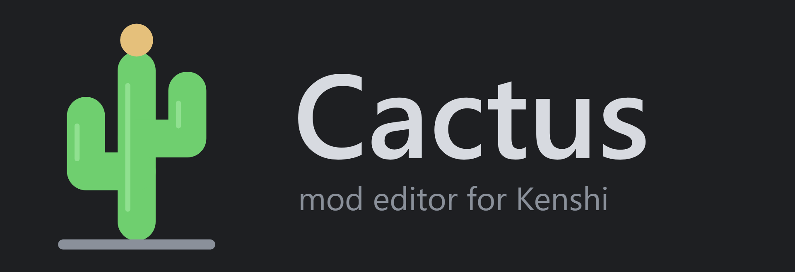
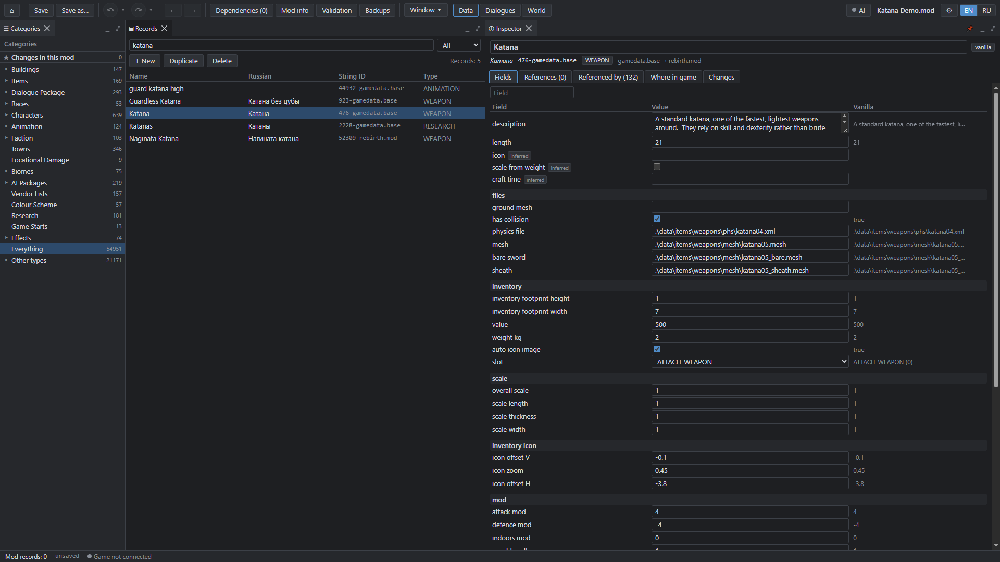
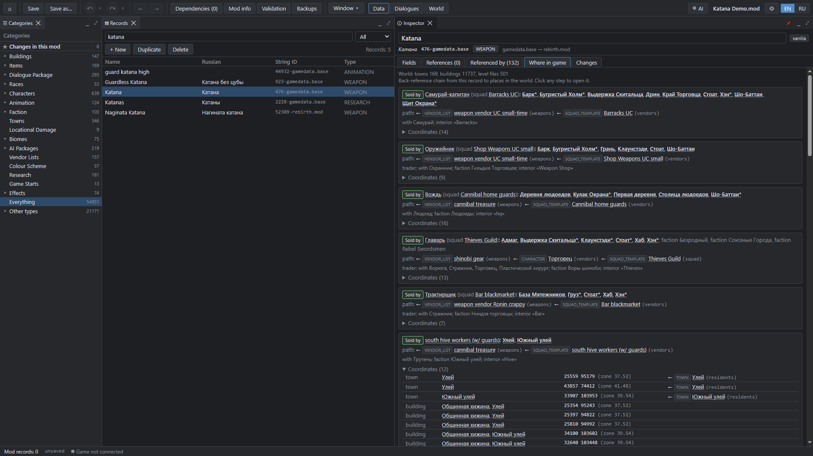
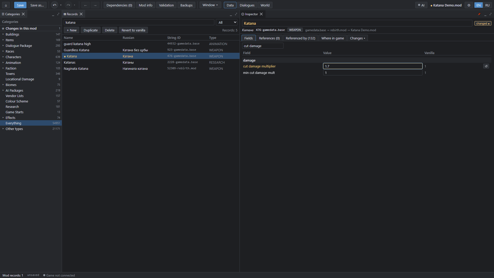
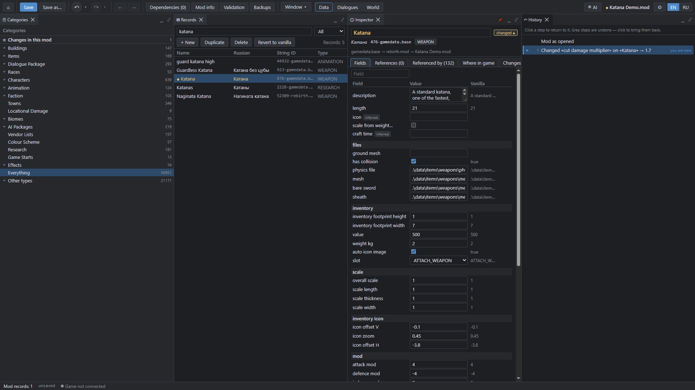
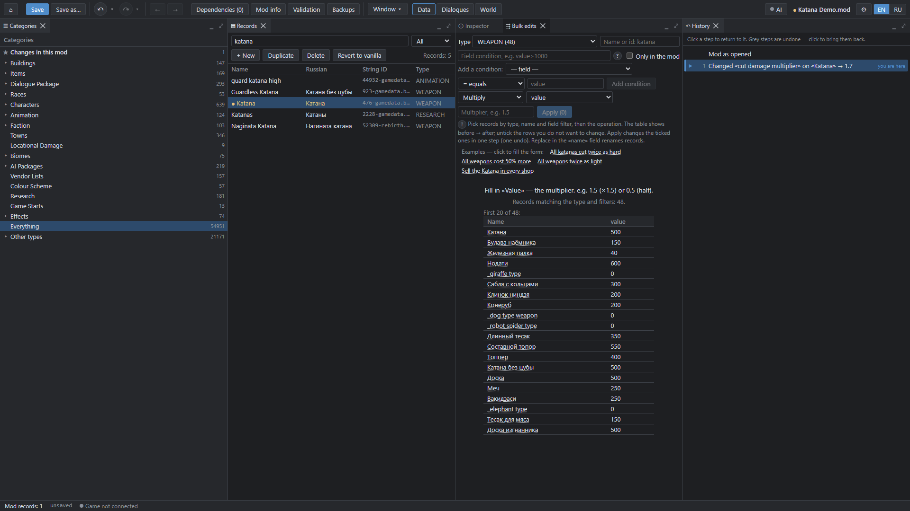
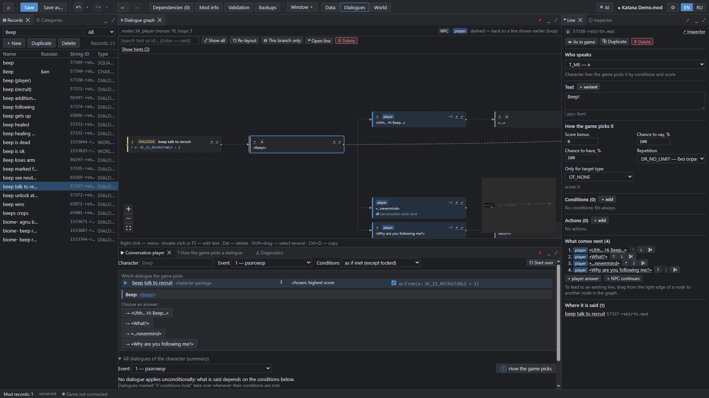
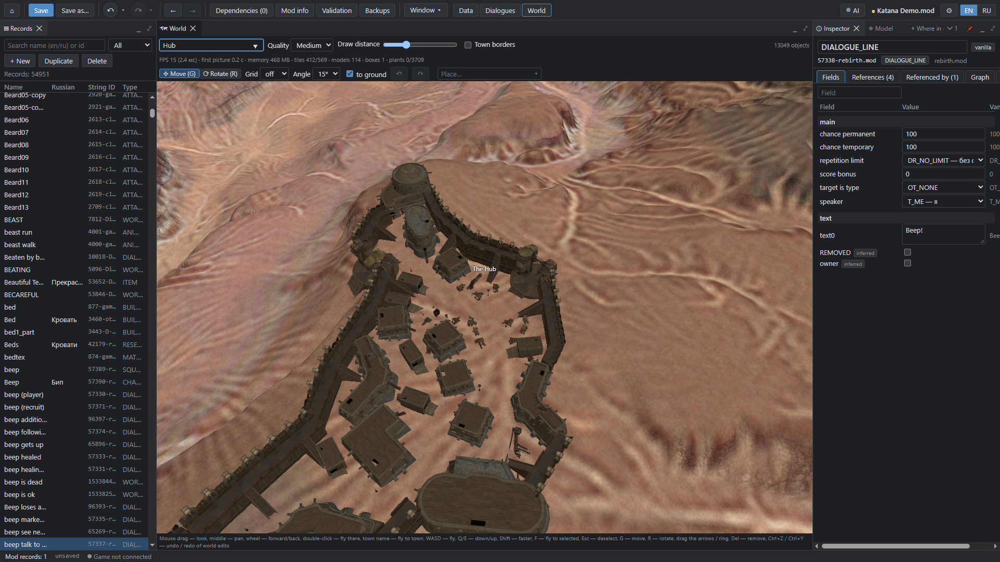
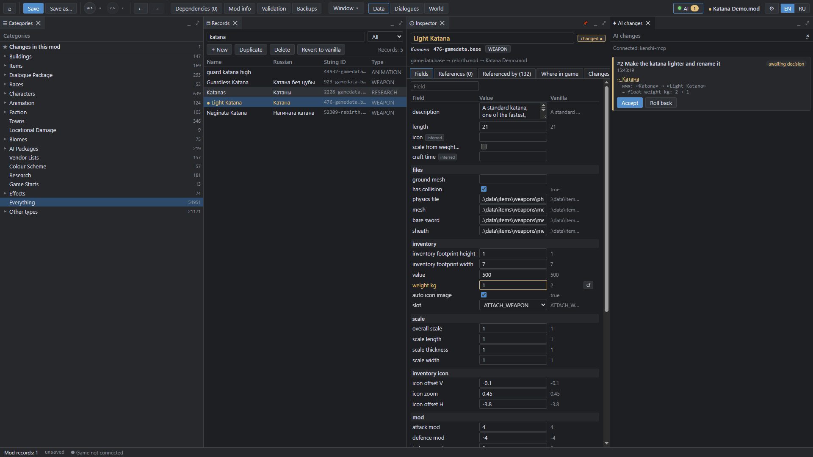

<p align="center">
  
</p>

# Cactus

<p align="center">
  <a href="https://github.com/Mrgoldd11/Cactus/releases/latest"></a>
  <a href="https://www.virustotal.com/gui/file/eee05703e485da655e3126733372ff3c86988e6a15b6c066547021f7cd6a5db7"></a>
</p>

<p align="center"><sub>Windows 10/11 x64 · free · Beta · <a href="https://github.com/Mrgoldd11/Cactus/releases/latest">Releases page</a> → <b>Assets</b> → <code>Cactus-0.1.0-beta-win-x64.zip</code></sub></p>

**A free mod editor for Kenshi** — a modern alternative to the FCS with a dialogue graph, a "where in the game" reference tracer, a world view and AI assistant integration (MCP).

> **v0.1.0 Beta.** Stable enough to build real mods, but young. Back up your `.mod` files and work on copies.



## Download

**[Cactus v0.1.0 Beta → Releases](https://github.com/Mrgoldd11/Cactus/releases/latest)** — on that page open **Assets** and download `Cactus-0.1.0-beta-win-x64.zip` (about 143 MB).

1. Unzip to a simple folder, e.g. `C:\Cactus` (don't run from inside the archive).
2. Run `Cactus.exe`. Nothing to install.
3. Windows may show "Windows protected your PC" because the app is not code-signed yet: **More info → Run anyway**.
4. Your Kenshi install (Steam/GOG) is found automatically; otherwise click *Choose folder…* and pick the folder with `kenshi_x64.exe`.

Requirements: Windows 10/11 x64, an installed copy of Kenshi. Cactus reads your own game files; nothing from the game is bundled.

### Is it safe?

The release archive was scanned on [VirusTotal](https://www.virustotal.com/gui/file/eee05703e485da655e3126733372ff3c86988e6a15b6c066547021f7cd6a5db7) on 2026-11-07: **0 of 65 engines flagged it**. You can check that the file you downloaded is the same one:

```
SHA-256  eee05703e485da655e3126733372ff3c86988e6a15b6c066547021f7cd6a5db7
         Cactus-0.1.0-beta-win-x64.zip
```

In PowerShell: `Get-FileHash .\Cactus-0.1.0-beta-win-x64.zip` — the value must match. The app is not code-signed yet (that is why Windows shows a warning), and the app has no telemetry or online features: the only connection it opens is a local one (127.0.0.1) for the AI/game integration.

## What it can do

| | |
|---|---|
|  | **"Where in game".** Follow a record's back-references all the way: item ← trader list ← squad ← town, with coordinates. |
|  | **Field editing** with the vanilla value always in view and one-click revert. |
|  | **History in plain words.** Every step is described; jump back to any of them. Autosave and safe saving with backups. |
|  | **Bulk edit with preview** ("was → will be"), applied as one undoable step. |
|  | **Dialogue graph and conversation player**, plus a "Talk" simulator showing which dialogue the game would pick for a character and why (rule taken from the game executable, Kenshi 1.0.65). |
|  | **World view** with buildings and town borders. |
|  | **AI integration.** Cactus ships an MCP server; any MCP-capable AI (tested with Claude) edits your mod live and its changes arrive as a reviewable change set you accept or revert. |

Also: mod load order and conflict view, mod merge, translation panel (CSV/PO/JSON), strict byte-for-byte `.mod` read/write, Russian and English interface.

### How it differs from the FCS
Cactus is not "FCS but prettier" — the FCS is a complete tool and has features Cactus lacks (see limitations). Cactus goes further in navigating references, dialogue understanding, bulk edits with preview, undo history, conflict analysis and AI assistance. A feature-by-feature comparison is planned.

## AI integration (MCP)
In Cactus: **Help → Connect AI (MCP)… → Copy**, then paste into Claude Desktop (*Settings → Developer → Edit Config*) or run the command in Claude Code. Ask: *"Find the katana and show where it is sold."* If Cactus is open, the AI works in your window and its edits show up in the "AI changes" panel.

Cactus speaks standard **MCP (stdio)**, so any MCP-capable AI client can connect: Claude Desktop, Claude Code and, in principle, ChatGPT-based tools, Qwen and other models. **Verified only with Claude** so far; other clients are untested, and reports are welcome. Ready-made setup snippets exist for Claude only; for other clients, point them at the same stdio command that *Connect AI (MCP)* copies.

The tool names, descriptions and parameters the AI sees are in **English**, so the AI can work in any language you talk to it in. Game record names are shown in both English and Russian. Some of the longer result texts (conversation simulator, "where in game", merge summaries) are still in Russian in this Beta; an AI reads them fine, but it is on the list to translate.

## Optional: Kenshi Bridge (live link to the running game)
[**Kenshi Bridge**](https://github.com/Mrgoldd11/Kenshi-Bridge) is a separate **open-source** (GPLv3) plugin for [RE_Kenshi](https://github.com/BFrizzleFoShizzle/RE_Kenshi) built on KenshiLib. With it Cactus and the AI can see the running game: the selected character and position, which dialogue the game actually chose and why, the town list with border radii, and (with your confirmation) teleport, camera, speed and pause. It is **not required**; Cactus works without it. Status: the plugin itself is checked in game, but the link between the Cactus window / AI tools and the plugin has **not been tested with the real game yet**. Cactus itself stays closed source; the two programs share no code and talk only over a local socket (`127.0.0.1`).

## Known limitations of the Beta
- Windows x64 only; zip + exe, no installer; not code-signed (SmartScreen warning).
- Tested mostly with Steam Kenshi 1.0.65 on one machine; GOG detection has had less testing.
- No Steam Workshop upload yet (use the FCS for that).
- Some FCS features are missing or weaker (cleanup/error-fixing window, configurable columns, notes, spell check, some dialogue templates, region map editor).
- World editing (placing/moving objects, building interiors) works in the editor window but has **not yet been checked in the running game**; treat it as experimental.
- Some panels are rough; it is a one-person project.

## Compatibility
Verified on **Kenshi 1.0.65 (Steam)**. Cactus reads `gamedata.base`, your mods and `mods.cfg` and writes standard `.mod` files. It does not touch saves and needs no game plugin (RE_Kenshi is not required; the Bridge above is optional). If a mod doesn't open, a value differs from the FCS, or the game rejects a mod after Cactus saved it — please open a **Compatibility issue**.

## Feedback
Use [GitHub Issues](https://github.com/Mrgoldd11/Cactus/issues/new/choose): **Bug report**, **Feature request**, **Compatibility issue**. Attach the version (*Help → About*), the log (*Help → Open log folder*), steps and a screenshot.

## License
Cactus is **free to use but closed source** (binaries only). See [LICENSE](LICENSE). Not affiliated with or endorsed by Lo-Fi Games.

---

## Download
**[⬇ Cactus v0.1.0 Beta — latest release](https://github.com/Mrgoldd11/Cactus/releases/latest)** → **Assets** → `Cactus-0.1.0-beta-win-x64.zip`. Unzip, run `Cactus.exe`. Steps are in [Download](#download) above.
Optional live link to the game: [Kenshi Bridge](https://github.com/Mrgoldd11/Kenshi-Bridge/releases/latest).
