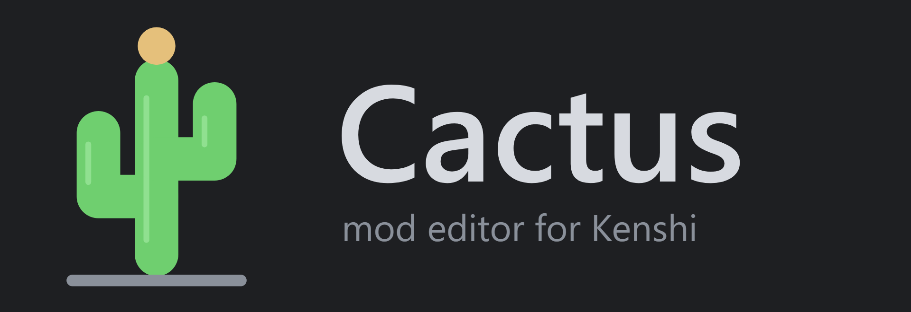
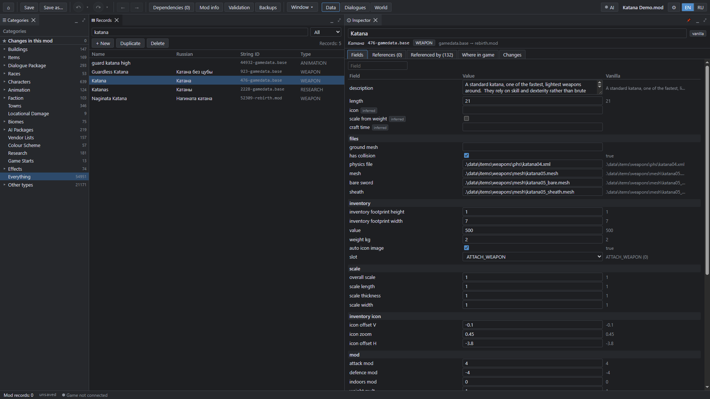
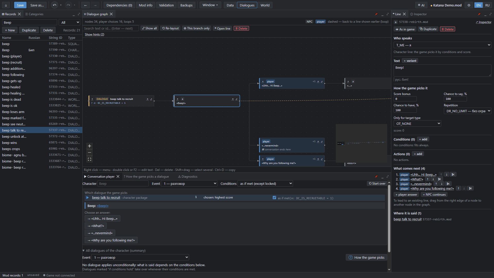
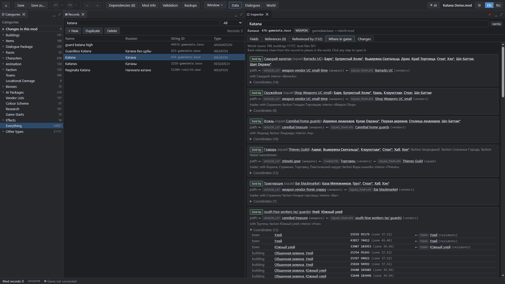
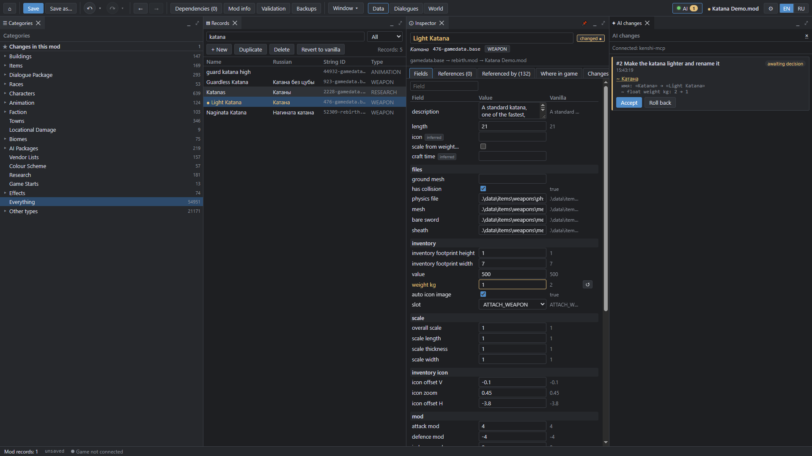
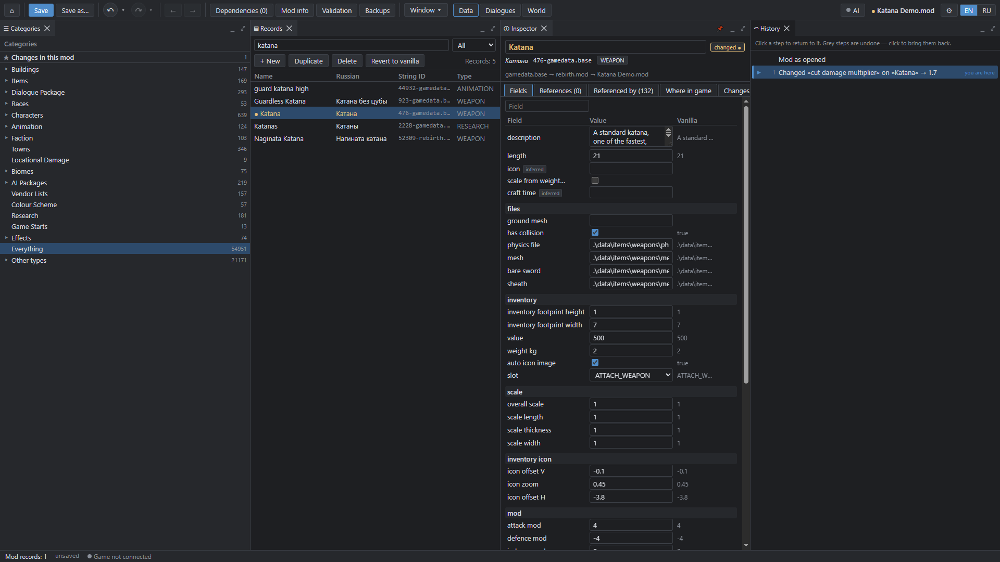

<p align="center">
  
</p>

# Cactus

<p align="center">
  <a href="https://github.com/Mrgoldd11/Cactus/releases/latest"></a>
</p>

<p align="center"><sub>Windows 10/11 x64 · free · <a href="https://github.com/Mrgoldd11/Cactus/releases/latest">Releases page</a> → <b>Assets</b> → <code>Cactus-1.0.0-win-x64.zip</code></sub></p>

**A free mod editor for Kenshi** — a modern alternative to the FCS with a dialogue graph, a "where in the game" reference tracer, diagnostics with one-click fixes, Steam Workshop publishing, a world view and AI assistant integration (MCP).

> **v1.0.0 — out of beta.** The dialogue editor is rebuilt (tree, line panel, ▶ Play), you can create your own creature and race, and look inside buildings. Back up your `.mod` files and work on copies. What changed: [release notes](docs/release-notes-v1.0.0.md).



## Download

**[Cactus v1.0.0 → Releases](https://github.com/Mrgoldd11/Cactus/releases/latest)** — on that page open **Assets** and download `Cactus-1.0.0-win-x64.zip` (about 144 MB).

1. Unzip to a simple folder, e.g. `C:\Cactus` (don't run from inside the archive).
2. Run `Cactus.exe`. Nothing to install.
3. Windows may show "Windows protected your PC" because the app is not code-signed yet: **More info → Run anyway**.
4. Your Kenshi install (Steam/GOG) is found automatically; otherwise click *Choose folder…* and pick the folder with `kenshi_x64.exe`.

Requirements: Windows 10/11 x64, an installed copy of Kenshi. Cactus reads your own game files; nothing from the game is bundled.

### Is it safe?

Check that the file you downloaded is the one that was built:

```
SHA-256  332ba4b369f6e9e36bb7de6f00f7610ae983d35df6ca8b656ae7b4e7e7fb2e1e
         Cactus-1.0.0-win-x64.zip
```

In PowerShell: `Get-FileHash .\Cactus-1.0.0-win-x64.zip` — the value must match. The app is not code-signed yet (that is why Windows shows a warning), and the app has no telemetry: it goes online only when you publish to the Workshop yourself (through your running Steam client); otherwise the only connection it opens is a local one (127.0.0.1) for the AI/game integration.

## New in 1.0

| | |
|---|---|
|  | **The dialogue editor is rebuilt**: a tree like the FCS, the graph reads left to right (event → who → dialogue), a line panel with conditions in plain words, and **▶ Play** under the graph showing how the game would pick a line. |
|  | **Create → Own creature…**: a new race and animal out of the game's own files (mesh, skeleton, texture), clip and ragdoll check, sale and start — one undo step. Race compatibility and Add animations wizards too. |
|  | **Inside view of buildings**: the shell, floors with a cutaway, click a prop in 3D. Plus the **Model panel** (Ogre skeletons, skin weights, clips with playback). |
|  | **Every record says whether it is in the game**, and the record list multi-selects (Ctrl/Shift) for bulk edits. Saving the mod, `mods.cfg` and settings is now atomic. |
|  | **The game through Kenshi Bridge**: spawn a character and screenshot the game window from the Game panel and from MCP (`game_spawn`, `game_screenshot`). |

Full list, known limitations and upgrade notes: [release notes v1.0.0](docs/release-notes-v1.0.0.md).

## What it can do

| | |
|---|---|
|  | **"Where in game".** Follow a record's back-references all the way: item ← trader list ← squad ← town, with coordinates. |
|  | **Field editing** with the vanilla value always in view and one-click revert. |
|  | **History in plain words.** Every step is described; jump back to any of them. Autosave and safe saving with backups. |
|  | **Bulk edit with preview** ("was → will be"), applied as one undoable step. |
|  | **Dialogue graph and conversation player**, plus a "Talk" simulator showing which dialogue the game would pick for a character and why (rule taken from the game executable, Kenshi 1.0.65). |
|  | **World view** with buildings and town borders. |
|  | **AI integration.** Cactus ships an MCP server; any MCP-capable AI (tested with Claude) edits your mod live and its changes arrive as a reviewable change set you accept or revert. |

Also: mod load order and conflict view, mod merge, translation panel (CSV/PO/JSON), strict byte-for-byte `.mod` read/write, English, Russian and Chinese interface.

### How it differs from the FCS
Cactus is not "FCS but prettier" — the FCS is a complete tool and has features Cactus lacks (see limitations). Cactus goes further in navigating references, dialogue understanding, bulk edits with preview, undo history, conflict analysis and AI assistance. A feature-by-feature comparison is planned.

## AI integration (MCP)
In Cactus: **Help → Connect AI (MCP)… → Copy**, then paste into Claude Desktop (*Settings → Developer → Edit Config*) or run the command in Claude Code. Ask: *"Find the katana and show where it is sold."* If Cactus is open, the AI works in your window and its edits show up in the "AI changes" panel.

Cactus speaks standard **MCP (stdio)**, so any MCP-capable AI client can connect: Claude Desktop, Claude Code and, in principle, ChatGPT-based tools, Qwen and other models. **Verified only with Claude** so far; other clients are untested, and reports are welcome. Ready-made setup snippets exist for Claude only; for other clients, point them at the same stdio command that *Connect AI (MCP)* copies.

The tool names, descriptions, parameters and server messages the AI sees are in **English**, so the AI can work in any language you talk to it in. `find` takes the same search conditions as the search box, `fix` / `cleanup` tools preview first and change the mod only with `apply: true`, and `game_spawn` / `game_screenshot` drive the game through the Bridge below.

## Optional: Kenshi Bridge (live link to the running game)
[**Kenshi Bridge**](https://github.com/Mrgoldd11/Kenshi-Bridge) is a separate **open-source** (GPLv3) plugin for [RE_Kenshi](https://github.com/BFrizzleFoShizzle/RE_Kenshi) built on KenshiLib. With it Cactus and the AI can see the running game: the selected character and position, which dialogue the game actually chose and why, the town list with border radii, a dump of the real foliage and buildings for the World view, and (with your confirmation) teleport, camera, speed and pause — plus spawning a character and a screenshot of the game window. It is **not required**; Cactus works without it. Checked in the running game with Cactus 1.0. Cactus itself stays closed source; the two programs share no code and talk only over a local socket (`127.0.0.1`).

## Known limitations
- Windows x64 only; zip + exe, no installer; not code-signed (SmartScreen warning).
- Tested mostly with Steam Kenshi 1.0.65 on one machine; GOG detection has had less testing.
- Before your first real Workshop upload, try a *Private* test item. Not there yet: updating the mod's info from Steam, an ownership pre-check, a BBCode preview.
- Some FCS features are missing or weaker (configurable columns, notes, spell check, some dialogue templates, region map editor).
- World editing (placing/moving objects, building interiors) works in the editor window but has **not yet been checked in the running game**; treat it as experimental.
- Some panels are rough; it is a one-person project.

## Compatibility
Verified on **Kenshi 1.0.65 (Steam)**. Cactus reads `gamedata.base`, your mods and `mods.cfg` and writes standard `.mod` files. It does not touch saves and needs no game plugin (RE_Kenshi is not required; the Bridge above is optional). If a mod doesn't open, a value differs from the FCS, or the game rejects a mod after Cactus saved it — please open a **Compatibility issue**.

## Feedback
Use [GitHub Issues](https://github.com/Mrgoldd11/Cactus/issues/new/choose): **Bug report**, **Feature request**, **Compatibility issue**. Attach the version (*Help → About*), the log (*Help → Open log folder*), steps and a screenshot.

## Made a mod with Cactus?
If you like, mention "Made with Cactus" in its description — just the name is enough, no link needed. Completely optional, but it helps other modders find the tool.

## License
Cactus is **free to use but closed source** (binaries only). See [LICENSE](LICENSE). Not affiliated with or endorsed by Lo-Fi Games.

---

## Download
**[⬇ Cactus v1.0.0 — latest release](https://github.com/Mrgoldd11/Cactus/releases/latest)** → **Assets** → `Cactus-1.0.0-win-x64.zip`. Unzip, run `Cactus.exe`. Steps are in [Download](#download) above.
Optional live link to the game: [Kenshi Bridge](https://github.com/Mrgoldd11/Kenshi-Bridge/releases/latest).
